<p align="center">
  
</p>

<p align="center">
  <b>jpac は、日本の「住所」を横断的に紐づけるためのデータ群です。</b><br>
  国の機関が自ら公開しているデータだけから作っています。
</p>

<p align="center">
  <a href="https://retro-maid.github.io/jpac/"><b>🗺️ 地図で見る</b></a> ・
  <a href="https://github.com/Retro-Maid/jpac/releases/latest"><b>⬇️ データをダウンロード</b></a>
</p>

<p align="center">
  <sub>地図：クリックした地点の市区町村・緯度経度・メッシュコードと、その市区町村の駅・郵便番号・市外局番・人口が出ます（ブラウザだけで動きます）<br>
  データ：Parquet 35.2 MB ／ CSV.gz 41.3 MB ／ SQLite 2.09 GiB ／ テーブル別 Parquet 177.8 MB</sub>
</p>

---

[概要](#概要) ・ [入手](#入手) ・ [クイックスタート](#クイックスタート) ・
[データの考え方](#データの考え方) ・ [フラット表の列](#フラット表の列) ・
[テーブル一覧](#テーブル一覧) ・ [鉄道とバス](#鉄道とバス) ・ [人口](#人口) ・
[廃置分合](#市区町村の廃置分合) ・ [学校](#学校) ・ [例](#例) ・ [クエリ例](#クエリ例) ・
[ER 図とスキーマ](#er-図とスキーマ) ・ [address_id](#address_id) ・ [元データ](#元データ) ・
[ライセンス](#ライセンス) ・ [静的マップ](#静的マップ) ・ [ビルドと検証](#ビルドと検証) ・
[ドキュメント](#ドキュメント)

**テーブルと列の詳細**（全テーブルの構造・型・キー・関係）は
[`docs/DATA_REFERENCE.md`](docs/DATA_REFERENCE.md) にあります。

---

## 概要

| | |
|---|---|
| 日本の「住所」を | デジタル庁が定める町字（「西新宿一丁目」までの単位）を、住所の基準として扱います |
| 横断的に紐づける | 郵便番号・市外局番・国土交通省コードとの対応を、どの方向からでも辿れます。郵便番号から住所へも、市外局番から郵便番号へも |
| データ群 | 1枚の表ではありません。44のテーブルからなり、対応と一緒にその根拠も保持します |

どこか1つの役所だけでは答えられない問いに答えるためのデータです。

- 郵便番号 → どの住所を覆うか
- 旧郵便番号 → 現行の郵便番号 → 住所 → 国土交通省コード
- 郵便番号 → 市外局番の候補 ／ 市外局番 → 番号区画 → 市区町村 → 郵便番号
- 国土交通省コード → 住所 → 代表点の緯度経度
- 市区町村 → 駅・路線・バス停
- 市区町村 → 人口・世帯数・年齢別人口（国勢調査 令和7年） ／ 旧い市区町村コード → 現行のコード

日本の「住所」は1つの役所が管理しているわけではなく、少なくとも4つの体系が別々の役所に
よって、別々の目的で並行して運用されています。

| 誰が | 何を | 目的 |
|---|---|---|
| デジタル庁 | 住所そのもの（町字） | 行政の基盤情報 |
| 日本郵便 | 郵便番号（現行7桁・旧3/5桁） | 郵便物の区分 |
| 国土交通省 | 大字・町丁目コードと代表点の緯度経度 | 位置の参照 |
| 総務省 | 市外局番と番号区画 | 電話番号の割り当て |

それぞれ自分の体系については正確ですが、互いの対応表はどこも公開していません。目的が違う
ため、区切り方も更新の時期も一致しません。市外局番の区切りは市区町村の区切りとすら一致
しません。

### 対象外

- 地図の座標を出すものではありません。国土交通省の緯度経度は町全体の代表点であり、建物の
  位置ではないため、配送や経路探索には使えません。駅とバス停の座標は本体とは別のファイル
  （[座標アセット](#座標アセット駅とバス停)）で配りますが、これも駅の代表点・発行元の
  停留所の点であって、駅舎・出入口・標識の位置ではありません。
- 番地・号は扱いません。粒度は「西新宿一丁目」までで、「1-2-3」は入っていません。
- Web サービスではありません。ダウンロードして使うファイルです。[静的マップ](#静的マップ)は
  サーバを持たない別の成果物で、リリースデータを問い合わせる手段ではありません。
- すべての住所に対応先があるわけではありません。対応が見つからなかったものは、埋めずに
  `unresolved` として残しています。

対象外の一覧と、分かっている制約は [`docs/LIMITATIONS.md`](docs/LIMITATIONS.md)。

---

## 入手

リリースデータは [GitHub Releases](https://github.com/Retro-Maid/jpac/releases/latest) で配布します。
リポジトリをクローンしても入りません（元データもリリースデータもバージョン管理に含めて
いないため）。

| ファイル | 中身 | 用途 |
|---|---|---|
| `jp_address_crosswalk.parquet` | 1枚にまとめた表（727,110行 × 43列） | polars / pandas / DuckDB |
| `jp_address_crosswalk.csv.gz` | 1枚にまとめた表 | 汎用・アーカイブ |
| `jp_address_crosswalk.sqlite.gz` | テーブル47本 + ビュー3本 + 索引36本（**gzip 433 MB。解凍して使います**） | SQL で関係をたどる |
| `jp_address_crosswalk_tables.zip` | テーブル別 Parquet 47本。中身は SQLite のテーブルと同じ | 人口・駅などを SQLite なしで読む |
| `jp_address_crosswalk_points.zip` | **座標アセット。** 駅の代表点 9,046、バス停の点 278,515、学校の点 56,807（Parquet 3本、約 7 MB）。本体には入っていない | 駅・バス停・学校を地図に載せる |
| `QUALITY_REPORT.md` | そのビルドの全統計とチェック結果 | 数値の裏取り |
| `DIFF_REPORT.md` | 前回リリースからの変化 | 更新時の影響確認 |
| `NOTICE.md` / `SOURCES.yml` | 出典表示と、使用した各ファイルの URL・SHA-256・規約 | 再配布・引用時 |
| `SHA256SUMS` | リリースする全ファイルのハッシュ（`sha256sum -c SHA256SUMS`） | 改ざん・破損の検証 |

2つのレポートは機械可読な `quality_report.json` / `diff_report.json` も添付されます。

**SQLite を gzip で配る理由。** GitHub のリリースアセットは1ファイル 2 GiB 未満という制限が
あり、非圧縮の SQLite は v1.2.0 の時点で 2,082,521,088 バイト（残り 62 MiB）でした。実測で
約5倍縮むので、上限に当たるのは非圧縮で約 10 GB になったときです。`SHA256SUMS` のハッシュは
**圧縮後のファイル**に対するもので、`csv.gz` と同じ扱いです。

**版。** タグはコード版とデータ版を併記します（`v2.3.0+data-2026-10-15`）。同じコードでも
元データの版が違えば中身は変わるため、利用時は**タグ全体**を記録してください。データ版は
**元データを取得した日のうち最も新しいもの**で、ビルド日ではありません（v1.2.0 まではその
記録が無く、ビルド日にフォールバックしていました）。取得日の署名は
[`docs/ACQUISITION_DATES.md`](docs/ACQUISITION_DATES.md)。

品質ゲートを通過したビルドだけがリリースされます。スキーマ変更・ライセンス変更・行数異常
などが1つでもあればリリースは作られません（[停止条件](docs/BUILD.md#停止条件)）。

---

## クイックスタート

1枚の表として集計するなら Parquet か CSV.gz、テーブル間の関係を辿るなら SQLite、人口や駅
など1枚の表に入らないテーブルだけを読むならテーブル別 Parquet の zip を使ってください。

```python
import polars as pl
x = pl.read_parquet("jp_address_crosswalk.parquet")   # 727,110行 × 43列

import pandas as pd
# CSV から読む場合は dtype=str が必須。指定しないと 0640941 が 640941 になります
x_pd = pd.read_csv("jp_address_crosswalk.csv.gz", dtype=str)

# テーブル別 Parquet（47本）は zip 1つにまとめてあります。zip は無圧縮なので展開は一瞬です
import zipfile
zipfile.ZipFile("jp_address_crosswalk_tables.zip").extractall("tables")
pop = pl.read_parquet("tables/census_population_municipality.parquet")

# 駅・バス停の座標は別の zip です（経緯度、JGD2011）。キーで本体の表に結びます
zipfile.ZipFile("jp_address_crosswalk_points.zip").extractall("points")
st = pl.read_parquet("points/station_point.parquet")      # n02_group_code で n02_station に 1対1
sc = pl.read_parquet("points/school_point.parquet")       # school_code で mext_school に結ぶ（キャンパスごと）
```

```bash
# SQLite は gzip で配っています。解凍してから開いてください
gunzip jp_address_crosswalk.sqlite.gz
sqlite3 jp_address_crosswalk.sqlite
```

### 郵便番号から住所を引く

```python
x.filter(pl.col("postal_code") == "1600023").select(
    "pref_name", "city_name", "town_name", "machiaza_id", "mlit_code",
    "postal_confidence", "postal_status",
)
# 8行返ります（西新宿一丁目〜八丁目）。1行ではありません
```

```sql
SELECT pref_name, city_name, town_name, machiaza_id, mlit_code,
       postal_relation_type, postal_confidence, postal_status
FROM   address_crosswalk
WHERE  postal_code = '1600023';
```

住所から引く場合も同じ表で、`town_name` ではなく `machiaza_id` か `address_id` を条件に
してください。町名は全国で重複します（[町名は識別子にならない](#町名は識別子にならない)）。

### 曖昧な対応を除く

`postal_status = 'auto'` は、候補が1件しかなく、公式のコード対応で確定した行だけを表します。

```python
confident = x.filter(pl.col("postal_status") == "auto")   # 674,578行
```

`LIMIT 1` や先頭行の採用は、複数ある正しい対応から任意の1件を選ぶことになります。絞るなら
順番ではなく根拠の列で絞ってください。曖昧な住所は結果に出ません。

### SQLite のビュー

| ビュー | 中身 |
|---|---|
| `address_crosswalk` | 現在有効な対応のフラット表。通常はこれを使います |
| `address_crosswalk_all` | 人手で棄却された対応や過去の版も含む全量 |
| `unmatched_records` | 対応が付かなかったレコード（`kind` / `record_id` / `matching_rule_id`） |

前者2つは要確認（`review_required`）の行も含みます。除きたい場合は `postal_status = 'auto'`
で絞ってください。棄却も退役もまだ発生していないため、この版では2つのビューの行数は同じ
（727,110行）です。

---

## データの考え方

### 基準の住所とブリッジ

中心に1本の基準となる住所があり、そこから他の体系へ対応表が伸びる構造です。この対応表を
ブリッジと呼びます。



<sub>図の出典: [`docs/diagrams/01-data-overview.mmd`](docs/diagrams/01-data-overview.mmd)。住所・郵便・国土交通省・市外局番の4系統の考え方を示す図で、件数は v1 時点のものです。全47テーブルは [ER 図](#er-図とスキーマ)を見てください。</sub>

- **基準となる住所** — デジタル庁の町字マスター。住所の名前と範囲は常にこれを基準にします。
- **各制度の記録** — 郵便番号、国土交通省コード、市外局番など。元のまま保存し、対応を取り
  やすくするための書き換えはしません。役所どうしで表記が食い違う場合は、その食い違いを
  そのまま残し、食い違っているという事実をブリッジに記録します。
- **ブリッジ** — 「AとBが対応する」という関係だけを、根拠と確からしさ付きで保持します。
  対応しなかったという事実もここに残ります。

住所と郵便番号のブリッジが2本あるのは、デジタル庁の公式の変換表による対応
（`bridge_address_postal_code`）と、日本郵便のファイルを名前で突き合わせて作った対応
（`bridge_address_postal`）を、混ぜずに分けて保存しているためです。前者は公式が明示した
対応、後者は照合結果であり、信頼度が異なります。

多対多の関係はすべてブリッジを経由します。1対1でないものを1対1の形に押し込めないため、
住所のテーブルに郵便番号の列を持たせる構造にはしていません。

| 何と何 | 関係 | 意味 |
|---|---|---|
| 住所 → 市区町村 | 多対一 | 1つの市区町村に多数の住所 |
| 住所 ↔ 郵便番号 | 多対多 | 1つの郵便番号が複数の住所を覆い、逆もある |
| 住所 ↔ 国土交通省コード | 多対多 | 粒度が完全には一致しない |
| 市区町村 ↔ 市外局番 | 多対多 | [小山市](#小山市には市外局番が4つある)のとおり |
| すべての行 → 取得元の記録 | 多対一 | どのファイルのどの版から来たかが必ず分かる |

### キー

| キー | 内容 | 例 | 発番元 |
|---|---|---|---|
| `address_id` | 住所1件ごとの永続 ID。jpac で唯一の主キー | `jpa1dy9jn5hy738r9wnb` | jpac |
| `lg_code` | 市区町村の番号（6桁） | `131041` = 新宿区 | デジタル庁 |
| `postal_code` | 郵便番号（7桁） | `1600023` | 日本郵便 |
| `mlit_code` | 国土交通省の大字・町丁目コード（12桁） | `131040023001` | 国土交通省 |
| `numbering_area_code` | 番号区画。市外局番はここにぶら下がる | `219` → 市外局番 `03` | 総務省 |

いずれも数字に見えますが型は文字列です。Excel や pandas で数値として読み込むと `0123` の
先頭の `0` が落ちて別の番号になります。`lg_code` は `013100` のように先頭がゼロになります。

駅・路線・バス停・人口・廃置分合のテーブルは、どれも **`lg_code`（市区町村）** で住所側に
繋がり、町字（`address_id`）までは降りません。

#### 町名は識別子にならない

「西新宿」という町は、東京都新宿区のほかに埼玉県蓮田市と兵庫県佐用町にもあります。同名の町
は全国に多数あるため、名前で名寄せをすると混ざります。一意なのは `address_id` だけです。

### 根拠の列

ブリッジのすべての行は、対応そのものと一緒にその根拠を持ちます。フラット表では
`postal_` ／ `mlit_` ／ `telephone_` の3系統が同じ8項目を持ち、系統をまたいだ処理は接頭辞を
差し替えるだけで書けます。

| ブリッジの列 | フラット表の列 | 意味 |
|---|---|---|
| `relation_type` | `*_relation_type` | 対応の付き方（下表） |
| `match_method` | `*_match_method` | どうやって対応を見つけたか |
| `matching_rule_id` | `*_rule` | 適用された照合規則の ID（[`docs/MATCHING_RULES.md`](docs/MATCHING_RULES.md)） |
| `confidence` | `*_confidence` | 確からしさ 0〜1。**確率ではありません**（下表） |
| `candidate_count` | `*_candidate_count` | 候補の件数。2以上なら1件に決まっていません |
| `candidate_group_id` | `*_candidate_group` | 候補が2件以上のときだけ入るグループ ID |
| `is_unique_match` | `*_is_unique` | 候補が1件に定まったか |
| `verification_status` | `*_status` | `auto`（自動確定）／ `review_required`（要確認）。スキーマ上は人手の判断 `manually_verified` / `manually_rejected` も取ります |

**relation_type**

| 値 | 意味 |
|---|---|
| `exact` | 同じ範囲。コードでも名前でも確認できた |
| `equivalent` | 公式のコード対応が「同じ」と述べている。名前までは独立に確認していない |
| `parent` / `child` | 一方がもう一方を含む／含まれる |
| `overlap` | 範囲が重なるが、どちらも相手を含みきらない |
| `ambiguous` | 候補が複数あり、どれか1つに決める根拠がない |
| `unresolved` | 対応先が見つからなかった。行は削除せず残してある |

スキーマの `CHECK` には `contains` と `candidate` も含まれますが、この版では0行です。

**confidence** は確率ではありません。0.99 は「99% の確率で正しい」ではなく、「発行元が公式に
出したコード対応である」という意味です。どの根拠で対応が付いたかを数値で表しただけなので、
平均を取ったり掛け合わせたりしても意味を持ちません。

| 値 | 根拠 |
|---|---|
| 1.00 | 発行元がコードで明示し、かつ別の項目もそれを裏づけている |
| 0.99 | この目的のために公開された、公式のコード対応 |
| 0.97 | 名前が一致し、双方向で1つに定まった |
| 0.95 | 公式の市区町村名リストの中で、ヶ/ケ の揺れを畳んで一意に定まった |
| 0.90 | 発行元が述べた構造的な親子関係／根拠つきの人手判断 |
| 0.70 | 市区町村までしか書かれていない |
| 0.50 以下 | 候補どまり。これだけでは確定しない |

**`auto` の条件。** 自動確定は次の6条件をすべて満たす行だけで、ブリッジの DDL がこの `CHECK`
で強制しています。照合コードに退行があっても、条件を満たさない行が `auto` として出力される
ことはありません。

```sql
CHECK (verification_status <> 'auto' OR (
    candidate_count = 1
    AND is_unique_match = 1
    AND candidate_count_is_complete = 1
    AND confidence >= 0.98
    AND override_stale = 0
    AND relation_type IN ('exact','equivalent')))
```

### NULL の3つの意味

1. **対応が見つからなかった** — `postal_code` や `mlit_code` の NULL。行は削除せず残して
   あるので、「探したが無かった」という記録です。`*_relation_type` が `unresolved` の行は
   これに当たります。
2. **その行には該当しない** — `ward_name` の NULL。政令指定都市の行政区でないだけです。
3. **その情報が不要** — `*_candidate_group` の NULL。候補が1件なら群を作る必要がありません。

`*_status` が NULL のときは、その系統の対応表にその住所の行自体が無いことを意味します。
ブリッジでは、**探した側は常に埋まり、相手側が NULL であることと `unresolved` であることが
同値**です（`CHECK` で強制）。相手が見つからなかった行も相手側を NULL にしたまま保存でき、
「相手がいない」と「解決した」を取り違えた行は DB が受け付けません。人口の NULL は理由を
`value_status` に持ちます（[人口](#人口)）。

### 表記を統一しない範囲

全角英数の半角化や、丁目の漢数字→算用数字といった変換はしますが、ヶ/ケ/が、ノ/之/の、
旧字体と新字体、高/髙、崎/﨑、カタカナとひらがなは統一しません。日本の地名ではこれらの
違いが意味を持つことがあり、統一していたら消えていた省庁間の実在する表記差が実際に検出
されているためです。

---

## フラット表の列

Parquet と CSV.gz、SQLite のビュー `address_crosswalk` は、いずれも同じ43列の1枚の表です。
ほとんどの用途はこの表だけで済みます。数値は `v2.3.0+data-2026-10-15`（727,110行）の実測値
です。この43列は v2.0.0 でブリッジの列名が変わったときも1列も変わっておらず、v2.1.0 以降の
追加（人口・廃置分合・座標・学校）もこの表には入りません（ファイルは v2.0.1 とバイト単位で同じです）。

1行は **1つの住所 × 対応する郵便番号 × 対応する国土交通省レコード** の組み合わせです。
住所726,170件に対して727,110行あるのは、対応が複数ある住所がその数だけ行に展開される
ためです（複数行になるのは591件、最多で40行）。対応が見つからなかった住所も必ず1行は
出ます。その場合、相手側の列が NULL になります。

> ⚠️ **この表に一意キーはありません。** `address_id` は重複します。`(address_id, postal_code)`
> でも4件だけ重複が残ります（国土交通省が同じコードに複数の代表点を持つ場合）。住所の件数を
> 数えるときは行数ではなく `address_id` の異なり数を使ってください
> （`x.height` は 727,110、`x["address_id"].n_unique()` は 726,170）。

### 住所（9列）

デジタル庁の町字マスター由来。全行に必ず入ります（`ward_name` を除く）。

| 列 | 型 | NULL | 例 | 内容 |
|---|---|---:|---|---|
| `address_id` | 文字列 | 0% | `jpa1dy9jn5hy738r9wnb` | 住所の永続 ID。20文字。行は重複しますが、住所の識別子はこれだけです |
| `lg_code` | 文字列 | 0% | `131041` | デジタル庁の市区町村コード6桁 |
| `jis_city_code` | 文字列 | 0% | `13104` | JIS 市区町村コード5桁。`lg_code` の先頭5桁と常に一致します |
| `pref_name` | 文字列 | 0% | `東京都` | 都道府県名。47種 |
| `city_name` | 文字列 | 0% | `新宿区` | 市区町村名。1,709種 |
| `ward_name` | 文字列 | 92.0% | `中央区` | 政令指定都市の行政区名。該当しない行は NULL |
| `town_name` | 文字列 | 0% | `西新宿一丁目` | 町字名。**ABR の表記のまま**で、「一丁目」と「２丁目」の混在もそのままです |
| `town_name_normalized` | 文字列 | 0% | `西新宿1丁目` | 照合に使った正規化後の表記。表記ゆれを跨いで突き合わせるときはこちら |
| `machiaza_id` | 文字列 | 0% | `0023001` | ABR の町字ID 7桁。**全国では一意ではありません**（異なり数 80,825）。一意になるのは `(lg_code, machiaza_id)` の組です |

### 郵便番号（10列）

| 列 | 型 | NULL | 例 | 内容 |
|---|---|---:|---|---|
| `postal_code` | 文字列 | 7.0% | `1600023` | 現行の郵便番号7桁。NULL は日本郵便側に対応が無い住所（51,009行） |
| `old_postal_code` | 文字列 | 7.0% | `02304` | 1998年以前の3桁または5桁。**複数ある場合は `;` 区切り**（例 `93021;93923`、186行） |
| `postal_relation_type` | 文字列 | 7.0% | `equivalent` | この表の郵便番号はデジタル庁の公式変換表由来のみなので、値は `equivalent` だけです |
| `postal_match_method` | 文字列 | 7.0% | `direct_code` | 対応の取り方。同上の理由で `direct_code` だけ |
| `postal_rule` | 文字列 | 7.0% | `P1` | 適用された照合規則。同上の理由で `P1` だけ |
| `postal_confidence` | 実数 | 7.0% | `0.99` | 公式のコード対応であることを表す値。確率ではありません |
| `postal_candidate_count` | 整数 | 7.0% | `1` | 候補の件数。1 が 674,578行、2以上が 1,523行（最大19） |
| `postal_candidate_group` | 文字列 | 99.8% | `grp_2d33f62b…` | 候補が2件以上のときだけ入る、同じ候補群を束ねる ID |
| `postal_is_unique` | 真偽 | 7.0% | `true` | 候補が1件に定まったか |
| `postal_status` | 文字列 | 7.0% | `auto` | `auto` 674,578行 ／ `review_required` 1,523行 |

名称照合で作ったもう1本の住所↔郵便番号の対応は、この表には入りません。信頼度の違うものを
同じ列に混ぜないためです。必要なら SQLite の `bridge_address_postal` を直接引いてください。

### 国土交通省（11列）

| 列 | 型 | NULL | 例 | 内容 |
|---|---|---:|---|---|
| `mlit_code` | 文字列 | 74.7% | `131040023001` | 大字・町丁目コード12桁 |
| `mlit_latitude` | 実数 | 74.7% | `35.690383` | 代表点の緯度。20.43〜45.51 |
| `mlit_longitude` | 実数 | 74.7% | `139.697501` | 代表点の経度。122.99〜146.33 |
| `mlit_relation_type` | 文字列 | 0% | `exact` | `exact` 168,390 ／ `equivalent` 15,722 ／ `ambiguous` 106 ／ `unresolved` 542,892 |
| `mlit_match_method` | 文字列 | 0% | `composite` | `composite` ／ `direct_code` ／ `normalized_name` ／ `unresolved` |
| `mlit_rule` | 文字列 | 0% | `M1` | `M1` 162,861 ／ `M2` 15,722 ／ `M3` 5,529 ／ `M4` 106 ／ `M5`（未対応）542,892 |
| `mlit_confidence` | 実数 | 0% | `1.0` | 0.0〜1.0。未対応の行は 0.0 |
| `mlit_candidate_count` | 整数 | 0% | `1` | 0 が 542,892行、1 が 184,112行、2 が 106行 |
| `mlit_candidate_group` | 文字列 | 100.0% | `grp_dfb194ef…` | 候補が2件以上のときだけ（106行） |
| `mlit_is_unique` | 真偽 | 0% | `true` | 候補が1件に定まったか |
| `mlit_status` | 文字列 | 0% | `auto` | `auto` 162,861行 ／ `review_required` 564,249行 |

対応率が低いのは欠損ではなく粒度の違いです。国土交通省側から見れば96%が繋がっています
（[到達率](#到達率)）。

### 市外局番（13列）

**この13列は現在すべて空です。** 総務省が町ごとの対応を公表していないため、意図的に埋めて
いません。市区町村単位で引く方法は [クエリ例](#クエリ例) にあります。

| 列 | 型 | 現在の値 |
|---|---|---|
| `area_code`（市外局番） ／ `numbering_area_code`（番号区画コード） ／ `numbering_area_name`（番号区画名） ／ `telephone_derivation`（対応の導出経路） | 文字列 | 全行 NULL |
| `telephone_relation_type` ／ `telephone_match_method` | 文字列 | `unresolved` |
| `telephone_rule` | 文字列 | `T10`（町単位では対応を作らない、という規則そのもの） |
| `telephone_confidence` | 実数 | `0.0` |
| `telephone_candidate_count` | 整数 | `0` |
| `telephone_candidate_group` | 文字列 | 全行 NULL |
| `telephone_is_unique` | 真偽 | `false` |
| `telephone_status` | 文字列 | `review_required` |
| `telephone_coverage_type` | 文字列 | `municipality_only`（公表されているのが市区町村までであることを示します） |

### 型について

`address_id` / `lg_code` / `jis_city_code` / `machiaza_id` / `postal_code` /
`old_postal_code` / `mlit_code` / `area_code` / `numbering_area_code` は**すべて文字列**です。
Parquet と SQLite は型を保持しますが、CSV を数値として読み込むと `0230401` が `230401` に
なります。pandas なら `dtype=str`、polars なら `infer_schema_length=0` を付けてください。
数値なのは `*_confidence`（実数）、`*_candidate_count`（整数）、`mlit_latitude` /
`mlit_longitude`（実数）、真偽値の `*_is_unique` だけです。

---

## テーブル一覧

> 件数は `v2.3.0+data-2026-10-15` の実測値です（品質チェック202項目すべて合格）。最新値は
> リリースに同梱される `QUALITY_REPORT.md` にあります。データ版 `+data-2026-10-15` は
> 元データを取得した日（最も新しいもの。今回は学校の2つ）です。住所・郵便番号・国土交通省・
> 市外局番・駅の元データは v2.0.1 と同じファイルです。

約72万件の住所を中心に、12万件の郵便番号、19万件の国土交通省コード、582件の番号区画、
9千件の駅、6万校の学校を繋いでいます。市区町村は1,918で、その人口と、コードの廃置分合の履歴も持ちます。
各テーブルの列・型・キーは [`docs/DATA_REFERENCE.md`](docs/DATA_REFERENCE.md)。

| 区分 | テーブル | 件数 | 中身 |
|---|---|---:|---|
| 住所 | `address` | 726,170 | 現在有効な住所（町字）。デジタル庁の町字マスター由来 |
| | `address_entity` | 726,170 | 住所の ID 台帳。一度でも観測した住所が1件1行。削除しない |
| | `address_code` | 2,178,510 | その住所が過去に持っていたコードの履歴（追記のみ） |
| | `address_rsdt_variant` | 727,418 | 住居表示のバリアント |
| | `address_history` | 0 | 属性が変わった記録 |
| | `address_lineage` | 0 | 分割・統合・改称・退役の記録 |
| | `address_key_conflict` | 0 | 元データのキーが衝突した記録 |
| 市区町村 | `municipality` / `municipality_version` | 1,918 | 市区町村と、その版（名前が変わったら上書きせず追加） |
| | `municipality_lineage_edge` | 2,528 | [廃置分合](#市区町村の廃置分合)の旧コード → 新コードの辺 |
| | `municipality_change_raw` | 3,739 | 廃置分合等情報の CSV の1行 = 1行 |
| 郵便 | `postal_code_entity` | 120,682 | 7桁の郵便番号そのもの |
| | `postal_record` / `postal_record_version` | 124,513 | 日本郵便のファイルの1行 = 1件。旧郵便番号もここ |
| 国土交通省 | `mlit_town` / `mlit_town_version` | 191,106 | 大字・町丁目。代表点の緯度経度つき |
| 市外局番 | `telephone_area` / `telephone_area_version` | 582 | 番号区画 |
| | `telephone_area_coverage` | 1,640 | 「この区画はどの市区町村を含むか」の公式文を1文ずつ構造化 |
| | `telephone_number_block` | 41,987 | 市内局番の割り当て |
| [鉄道とバス](#鉄道とバス) | `n02_station` | 9,046 | 駅（駅グループ単位） |
| | `n02_railroad_line` | 596 | 路線。鍵は発行元自身の `(路線名, 運営会社)` |
| | `p11_bus_stop` | 278,515 | バス停留所。名称・事業者・都道府県 |
| | `estat_small_area` | 232,019 | e-Stat 国勢調査 小地域の属性。**形状は含みません** |
| [人口](#人口) | `census_population_*` 5本 | 下記 | 市区町村・年齢・番号区画ごとの人口と、発行元の表の原文 |
| [学校](#学校) | `mext_school` | 59,738 | 学校1校1行（廃止した学校を含む）。文部科学省 学校コード |
| | `mext_school_succession` | 1,797 | 廃止した学校 → 移行後の学校 |
| ブリッジ | `bridge_*` 12本 | 下表 | 対応とその根拠 |
| 来歴 | `source_snapshot` | 126 | 取得したファイル1本 = 1行。URL・SHA-256・規約・行数 |
| | `match_run` / `match_run_input` | 1 / 122 | 照合の実行と、その入力 |
| | `snapshot_license_artifact` | | 規約本文の記録 |

`address_history` / `address_lineage` / `address_key_conflict` が0件なのは欠損ではなく、
**元データがまだ一度も更新されていないため**です（取得は 2026-08-23、以降の全リリースが同じ
payload から作られています）。v2.0.0 以降、この3本はリリースをまたいで積まれます
（[`docs/LIMITATIONS.md`](docs/LIMITATIONS.md) 項目7）。

日本郵便のファイルには住所ではない特殊なレコードが混ざります。内訳は通常の町字 122,603 件、
「以下に掲載がない場合」1,870 件、「〜一円」23 件、「〜の次に番地がくる場合」17 件。
「以下に掲載がない場合」は特定の町ではなく、その市区町村のうち個別の郵便番号が振られて
いない部分をまとめて表す行なので、市区町村レベルの対応表に振り分けています。

### ブリッジ

| ブリッジ | テーブル | 行数 | 対応がついた割合 | 自動確定 |
|---|---|---:|---:|---:|
| 住所 ↔ 郵便番号（公式の変換表） | `bridge_address_postal_code` | 676,124 | 99.996% | 674,574 |
| 住所 ↔ 郵便番号（名称照合） | `bridge_address_postal` | 352,499 | 78.86% | 0 |
| 住所 ↔ 国土交通省コード | `bridge_address_mlit` | 733,948 | 24.99% | 162,057 |
| 住所 ↔ 市外局番 | `bridge_address_telephone` | 726,170 | 0%（全件が意図的に空） | 0 |
| 市区町村 ↔ 郵便番号（変換表の市区町村レベル行） | `bridge_municipality_postal_code` | 8,207 | 100% | 0 |
| 市区町村 ↔ 日本郵便の特殊レコード | `bridge_municipality_postal` | 1,910 | 100% | 0 |
| 市区町村 ↔ 市外局番 | `bridge_municipality_telephone` | 2,153 | 100%（うち候補どまり 1.068%） | 0 |
| 駅 ↔ 市区町村 | `bridge_station_municipality` | 9,061 | 99.96%（9,046駅のうち4駅が未確定） | 9,027 |
| 駅 ↔ 路線 | `bridge_station_line` | 10,153 | | |
| 路線 ↔ 市区町村 | `bridge_line_municipality` | 3,381 | | |
| バス停 ↔ 市区町村 | `bridge_bus_stop_municipality` | 278,801 | | 278,114 |
| 学校 ↔ 町字・市区町村 | `bridge_school_address` | 59,952 | 町字まで 94.85%（今ある学校 55,862校） | 54,153 |

市区町村 ↔ 郵便番号が2本あるのは、v2.0.0 で表を2つに分けたからです（`P2` は郵便番号を
直接指し、`P3` は日本郵便のレコードを指すので、同じ列に入れると join の前に規則で分岐する
必要がありました）。合計は分割前と同じ 10,117 です。

### 到達率

| 繋がり先 | 到達率 | 読み方 |
|---|---:|---|
| 郵便番号 | 93.0% | 675,161 / 726,170 件。うち 674,574 は自動で確定、587 は要確認 |
| 国土交通省 | 25.3% | 低いのは欠損ではなく粒度の違い。国土交通省側から見れば 183,382 / 191,106 = 96% が繋がっている |
| 市外局番 | 99.7% | 市区町村単位で 1,912 / 1,918。未達は北方領土の6件のみ |
| 駅 → 市区町村 | 99.96% | 9,042 / 9,046 駅。未達の4駅は埋立地や水域で、最寄りには寄せていません |

繋がらなかったレコードも保持しています。住所 542,792 件、郵便レコード 25,647 件、
国土交通省 7,774 件。

---

## 鉄道とバス

国土数値情報の駅・路線（N02、2025年版）とバス停留所（P11、**令和4年度版**）を、e-Stat の
国勢調査 小地域境界（2020年）で市区町村に結びます。どれも**市区町村まで**で、町字には
結びません（e-Stat の小地域は jpac の町字より約3.1倍粗く、面を町字に展開すると誤りになる
ため）。境界の形状はビルド時に読むだけで、リリースデータには入りません
（[`docs/POLICY.md`](docs/POLICY.md) §3.1）。

- **どの境界にも入らない点は最寄りに寄せず `unresolved` のまま残します**（駅4つ・バス停115件。
  埋立地や水域）。境界が重なる場所で2つに入るもの（府県境をまたぐ大阪空港、バス停10件）は
  候補を両方残します。
- **要確認の内訳。** 駅は34行（旧北区の14駅〔候補2つなので28行〕・大阪空港 2・境界外 4）、
  バス停は687行（旧北区の276停留所〔候補2つで552行〕・境界の重なり 20・境界外 115）。バス停のある市区町村は1,799。
- **路線**は線上の点のサンプリングで判定します（刻みは全国データで測って 25m）。乗換駅は
  `bridge_station_line` で複数行になり（826駅）、路線が通る市区町村は1,446（最多は東海道
  新幹線の97）。40の市区町村を通る路線は「40行の正しい答え」であって曖昧さではないので、
  駅と違い一意性は要求しません。
- **バス停には発行元の ID が無く、属性のどの組み合わせも一意になりません。** 278,515停留所に
  対して (名称, 事業者) は276,169通りしかなく、衝突する2,035組は上り/下りのペアではありません
  （グループ内の最大距離は中央値16.4km、129組は県をまたぐ）。`p11_stop_id` は「行の識別子」と
  しての代理キーで、`address_id` のような実体の同一性ではありません。
- **P11 は令和4年度版のみです。** 平成22年度版は「非商用」で複製物の再配布が除外されており、
  N07バスルートも全版が同じ条件なので、どちらも対象外です（[`DATA_LICENSE.md`](DATA_LICENSE.md)）。

**版のズレは承継記録で読み替えています。** 境界データは2020年の断面なので、2024-01-01 の
区再編より前の旧浜松市7区のコードを持っています。該当する54駅と1,218停留所は
[`overrides/municipality_lineage.yml`](overrides/municipality_lineage.yml)（一次資料を人が読んで
署名した承継記録）を経て現行の市区町村に解決し、`match_method = 'spatial_containment_via_lineage'`
で示します（駅 68行・バス停 1,494行。旧区の区域は新区の内側なので、承継を経ても「含まれる」は
含まれるままです）。承継先が一意でない旧北区（中央区と浜名区に分割）は、
どちらかに決めず候補を2つ残します。

> ⚠️ `match_method = 'spatial_containment'` で絞ると、この承継経由の行が静かに落ちます。
> 空間で解決した行を全部ほしいときは `match_method LIKE 'spatial_containment%'` か、
> `verification_status` で絞ってください。

### 座標アセット（駅とバス停）

駅・バス停（v2.3.0 からは学校も）の経緯度は、本体（SQLite・Parquet・CSV・テーブル別 zip）には入れず、別ファイル
`jp_address_crosswalk_points.zip` で配ります。本体を使っている人の手元は何も変わらず、
座標が要る人だけがこの zip を取ります（[`docs/POLICY.md`](docs/POLICY.md) §3.4）。

| 表 | 行 | キー | 点 |
|---|---:|---|---|
| `station_point` | 9,046 | `n02_group_code`（`n02_station` と1対1） | **代表点。** N02 は駅を線で公開していて点を持たないので、駅の線から計算した重心です。`bridge_station_municipality` が市区町村の判定に使った点と同じで、`placement_point` にその規則（`centroid` / `point_on_line`）が入ります。6桁に丸めています |
| `bus_stop_point` | 278,515 | `p11_stop_id`（`p11_bus_stop` と1対1） | **発行元の点そのもの。** P11 が公表している点を、計算も丸めもせずに出しています |
| `school_point` | 56,807 | `(school_code, campus_code)`（`mext_school` に学校コードで結ぶ） | **発行元の点そのもの**（国土数値情報 P29 2023年度版）。学校 × キャンパスごと。詳しくは [学校](#学校) |

- 測地系は JGD2011 の経緯度（EPSG:6668）。`longitude` と `latitude` は `REAL`（Parquet では double）。
- 元の表のすべての行に1行あります。図形が無い駅・バス停は座標を NULL にして行を残します
  （v2.3.0 の元データでは 0 件）。
- 市区町村はこの表には無く、これまでどおりブリッジ（`bridge_station_municipality` /
  `bridge_bus_stop_municipality`）から引きます。境界上の駅・バス停は候補が2つのままです。
- 駅の点は**駅舎や出入口の位置ではありません**。バス停の点も**停留所標識の位置とは限りません**。
  再配布するときは N02・P11 の出典表示（[`DATA_LICENSE.md`](DATA_LICENSE.md)）を一緒に付けてください。

設計と測定: [`docs/STATION_JOIN_PLAN.md`](docs/STATION_JOIN_PLAN.md) ・
[`docs/RAILROAD_LINE_PLAN.md`](docs/RAILROAD_LINE_PLAN.md) ・
[`docs/BUS_STOP_PLAN.md`](docs/BUS_STOP_PLAN.md) ・
[`docs/ESTAT_BOUNDARY_VERIFICATION.md`](docs/ESTAT_BOUNDARY_VERIFICATION.md)。

---

## 人口

令和7年国勢調査 人口等基本集計（総務省統計局、2026-09-29 公表、**2025年10月1日現在**）の
原数値を、市区町村と市外局番の番号区画に結びます。粒度は**市区町村まで**で、町字や郵便番号
には結びません。フラット表には入らないので、SQLite かテーブル別 Parquet で読み、
**`lg_code` で結合**してください。

| テーブル | 行数 | 中身 |
|---|---:|---|
| `census_population_municipality` | 1,918 | 市区町村ごとの人口（総数・男・女）、世帯数・世帯人員（一般・施設等）、2020年の人口・世帯数（2025年の境域に組み替えた公式値）。**まずはこれを使ってください** |
| `census_population_age` | 538,824 | 5歳階級の年齢別人口（21区分と年齢「不詳」）。国籍総数／日本人 × 男女の縦持ち |
| `census_population_age_summary` | 24,492 | 平均年齢・年齢中位数（公表値のまま） |
| `census_population_numbering_area` | 582 | 番号区画ごとの人口。**値があるのは301区画だけ**（下記） |
| `census_population_raw` | 4,082 | 発行元の表の1行 = 1行。全セルを文字列のまま |

```sql
-- 住所に、その市区町村の人口を付ける
SELECT a.address_id, a.town_name, p.population_total, p.households_total
FROM   address_crosswalk a
JOIN   census_population_municipality p USING (lg_code)
WHERE  a.postal_code = '1600023';

-- 全国の人口（122,972,528）。政令市の親の行（area_level = '1'）を除いて足す
SELECT sum(population_total)
FROM   census_population_municipality
WHERE  area_level <> '1';

-- 新宿区の 65歳以上（国籍総数・男女総数）
SELECT sum(population)
FROM   census_population_age
WHERE  lg_code = '131041'
  AND  nationality_raw = '0_国籍総数' AND sex_raw = '0_総数'
  AND  age_class_raw >= '14' AND age_class_raw < '22';   -- 14_65～69歳 〜 21_100歳以上
```

> ⚠️ **政令市は、市全体の行（`area_level = '1'`、20市）と区の行（`'0'`）の両方が載っています。**
> そのまま全部足すと政令市の人口を二重に数えます。合計を出すときは `area_level <> '1'`
> で絞ってください。市全体の値がほしいときは `'1'` の行をそのまま使えます。

- **公表された件数だけを持ちます。按分はしません。** 推計や補完をした値はなく、統計局が
  「不詳」を補完した推計値（不詳補完値）も使いません。面積と人口密度も載せません。
- 北方領土の6村は国勢調査の対象外で、値は NULL、`value_status = 'not_enumerated'` です。
  「-」（該当数値がないもの）は件数では 0、率では NULL で、元の文字列は `*_raw` に残ります。
- 年齢のテーブルは全国・都道府県・特別区部・2000年の境域の市区町村の行も持ち、それらは
  `lg_code` が NULL です。市区町村だけを見るなら `lg_code IS NOT NULL` で絞ってください。
- 番号区画の人口は、属する市区町村がすべて丸ごと含まれる301区画だけ値を持ちます。郵便番号
  ごとの人口は持ちません。

品質チェック（`census_tables_consistent`）で、男女の和、都道府県・全国の合計、政令市と区の
合計、年齢の和が第1-1表の総数と一致することを毎回確かめています。
設計と実測: [`docs/POPULATION_PREFLIGHT.md`](docs/POPULATION_PREFLIGHT.md)。

---

## 市区町村の廃置分合

e-Stat「廃置分合等情報」（1970-04-20〜2024-01-01 の施行分）から、古いデータに残る市区町村
コードを現行のコードに読み替えるための旧→新の対応を作ります。`municipality_lineage_edge`
が辺（施行日・事由 `event_type`・候補数・一意かどうか）、`municipality_change_raw` が発行元の
CSV の1行 = 1行（原文を `*_raw` のまま保持し、解析の結果を添えたもの）です。

```sql
-- 旧浜松市中区（221317）は、2024-01-01 にどのコードへ移ったか
SELECT effective_date, new_lg_code, event_type, candidate_count, is_unique_match
FROM   municipality_lineage_edge
WHERE  old_lg_code = '221317';
```

- **一意に決まる辺（`is_unique_match = 1`）は 2,383本です。** 分割や分離では旧コードに
  複数の行き先があり、`candidate_count` が2以上になります。どれか1つに決めてはいけません。
- 旧コードが分離のあとも残る場合は、存続の辺（`event_type = 'continues'`、旧→旧）を
  持ちます。これが無いと「分離した先だけが唯一の行き先」に見えてしまうためです。
- 改正事由の文面を規則で読み、読めたものだけを辺にします。推測しないと読めない10行は
  `municipality_change_raw.parse_status = 'unresolved'` のまま残し、辺にしていません
  （鳳至郡の2町の郡変更、上九一色村の大字単位の分割など）。
- 旧→新を1段ずつ持つ表です。何度も合併した市町村を現行まで辿るときは、施行日の順に
  辺をつないでください。

設計と実測: [`docs/MUNICIPALITY_LINEAGE_PREFLIGHT.md`](docs/MUNICIPALITY_LINEAGE_PREFLIGHT.md)。

---

## 学校

> **v2.3.0 で追加しました。** 数値は令和7年5月1日時点（確定版）の一覧を照合した `v2.3.0+data-2026-10-15`
> の実測です。

文部科学省の「学校コード」一覧（幼稚園・認定こども園から大学・専修学校まで、廃止した学校を
含む 59,738校）を、**所在地の文字列で町字（`address_id`）に結びます**。駅やバス停と違い、町字
まで届きます。学校の**座標**は、国土数値情報の学校データ（P29 2023年度版）の点を、座標アセット
（`jp_address_crosswalk_points.zip`）の `school_point` として別に配ります。

| テーブル | 行数 | 中身 |
|---|---:|---|
| `mext_school` | 59,738 | 学校1校1行。学校種・設置区分・本分校をコードと名前に分けて持つ |
| `mext_school_succession` | 1,797 | 廃止した学校 → 移行後の学校（統合・分離で1校が複数に移ることがある） |
| `bridge_school_address` | 59,952 | 学校 → 町字・市区町村。根拠の列つき |
| `school_point`（座標アセット） | 56,807 | 学校 × キャンパスの点（P29 の公表値）。学校コードで `mext_school` に結ぶ |

今ある学校 55,862校のうち、町字が1つに決まったのは **94.85%** です。

| 結果 | 学校数 | 割合 |
|---|---:|---:|
| 町字が1つに決まった（`located_in`） | 52,985 | 94.85% |
| 同じ名前の町字が複数（`ambiguous`、候補ごとに1行） | 192 | 0.34% |
| 市区町村まで（`municipality_only`） | 2,663 | 4.77% |
| 市区町村も決まらない（`unresolved`） | 22 | 0.04% |

- **町字名の直後が番地のときだけ結びます。** 「小野田２２番地」を、名前の短い別の町字「小野」に
  結ばないためです。表記の揺れ（ヶ／ケ、「字」の省略、京都の通り名）は推測せず、市区町村どまり
  にします。
- **郵便番号は照合に使わず、裏づけに使います。** 学校の郵便番号がその町字の郵便番号と合えば
  `verification_status = 'auto'` です。合わない学校の多くは大学などの事業所個別番号です。
- **点は P29 の公表値で、町字の決め方とは独立です。** 今ある学校の 98.1%（54,776校）に点が
  あります。無いのは P29 の時点（2023年）より後にできた学校が中心です（認定こども園 729校など）。
  キャンパスが複数ある学校は点も複数です（`campus_code`）。
- P29 の詳細ページは原典資料に地理院地図と「測量法に基づく国土地理院長承認（使用）」を挙げて
  います。いったん見送ったレイヤで、2026-10-15 に座標のためだけに採用しました
  （[`docs/POLICY.md`](docs/POLICY.md) §3.5）。

```sql
-- 町字ごとの、今ある小学校
SELECT a.full_name_raw, s.school_name_raw, b.postal_check
FROM   bridge_school_address b
JOIN   mext_school s ON s.school_code = b.school_code
JOIN   address a     ON a.address_id = b.address_id
WHERE  b.lg_code = '131041' AND s.school_type_code = 'B1' AND s.is_active = 1;
```

列の定義: [`docs/DATA_REFERENCE.md`](docs/DATA_REFERENCE.md) 7.9。

---

## 例

以下はすべて実際のビルド結果です。

### 郵便番号 1600023 は8件の住所に対応する

| 住所 | 郵便番号 | 国土交通省コード | jpac の ID |
|---|---|---|---|
| 東京都新宿区西新宿一丁目 | 1600023 | 131040023001 | `jpa1dy9jn5hy738r9wnb` |
| 東京都新宿区西新宿２丁目 | 1600023 | 131040023002 | `jpa1d3c2z1tmnb0bnkcr` |
| 東京都新宿区西新宿３丁目 | 1600023 | 131040023003 | `jpa11p02cf9zmvg3f57r` |
| …（四〜七丁目も同じ） | | | |
| 東京都新宿区西新宿８丁目 | 1600023 | 131040023008 | `jpa1tgdzg4wsmchae4e0` |

1つの郵便番号が1つの住所を指すとは限らないため、jpac は8件すべてを根拠の列とともに返します。
最も多いのは山口県長門市の `7594401` で、614件の住所を覆っています。小字が細かく分かれて
いる地域に、郵便番号が広めに割り当てられているためです。

### 小山市には市外局番が4つある

栃木県小山市の市外局番は `0285` ／ `0280` ／ `0282` ／ `0296` です。市外局番の区切りは
市区町村の区切りと一致せず、3つ以上にまたがる市区町村は17あります（京都市・西宮市・新潟市・
高山市・萩市・東広島市など）。総務省が公表しているのは「この区画はこの市区町村を含む」
までで、どの町がどちらの局番かは公表していません。jpac も町ごとの市外局番は NULL のままに
しています。推測で埋めると、公式が述べていないことを述べたことになるためです。

### 旧郵便番号 160 は現行の60件に分かれる

1998年に郵便番号が3桁・5桁から7桁になったとき、1つの旧番号は複数の新番号に分かれました。
旧 `160` は `1600001`（新宿区片町）・`1600005`（愛住町）・`1600016`（信濃町）・
`1600018`（須賀町）…と、全部で60個の現行番号に対応します。古い名簿や台帳を現在のデータと
突き合わせる際に必要になる対応です。

---

## クエリ例

どの例も根拠の列を一緒に返します。曖昧さを隠すための `LIMIT 1` は使いません。

```python
# 自動で確定した対応だけを取り出す（曖昧なものは返さない）
confident = x.filter(
    pl.col("postal_relation_type").is_in(["exact", "equivalent"])
    & (pl.col("postal_status") == "auto")
)
```

```sql
-- 郵便番号 -> 市区町村レベルの市外局番候補（docs/queries/04_postal_to_area_code.sql と同じ問い）
-- 総務省は町ごとの対応を公表していないため、これは意図的に市区町村の対応です
SELECT DISTINCT x.postal_code, t.area_code,
       b.numbering_area_code,
       b.relation_type, b.coverage_type, b.confidence
FROM   address_crosswalk x
JOIN   bridge_municipality_telephone b ON b.lg_code = x.lg_code
JOIN   telephone_area_version t
       ON t.numbering_area_code = b.numbering_area_code AND t.is_current = 1
WHERE  x.postal_code = '0640941'
ORDER  BY t.area_code;
```

そのまま実行できる SQL は **[`docs/queries/`](docs/queries/README.md)** に索引と結果の読み方つきで
置いてあります。郵便番号・旧郵便番号・国土交通省コード・市外局番の相互変換、曖昧な対応や
未対応のレコード、来歴のほか、駅・路線・バス停・人口・廃置分合を使うものもあります。
`docs/queries/*.sql` はビルドのたびに実際に実行して検証しています。

```bash
sqlite3 jp_address_crosswalk.sqlite < docs/queries/01_postal_to_address.sql
```

---

## ER 図とスキーマ



全47テーブルと座標アセットの3表を領域ごとにまとめた概観です。矢印は参照する側 → 参照される側で、実線は宣言
された `FOREIGN KEY`、破線は宣言していない論理的な結合（実体と `*_version`、人口の `lg_code`
など）です。全列を載せた版は **[`docs/diagrams/er/jpac-er.pdf`](docs/diagrams/er/jpac-er.pdf)**
（9ページ、しおりつき。拡大して読む用。8ページ目が座標アセット、9ページ目が学校）。どちらも
[`docs/schema.sql`](docs/schema.sql) と座標アセットの定義（`build/points.py`）から
`py -3.12 tools/build_er.py` で生成し、`jpac verify er` で同期を確かめています。

**実体と版。** 多くの実体は実体の表と版の表（`*_version`）に分かれています。名前や区域の
記述が変わったとき、上書きせずに新しい版を足し、前の版は `is_current = 0` を立てて残します。
実体の表は ID だけを持つ薄い表で、属性は版の表にあります（例：`municipality` は3列、
`municipality_version` は21列）。

**ブリッジの端点。** 住所・市区町村と郵便・国土交通省・市外局番をつなぐブリッジ7本は
すべて同じ30列で、違うのは端点の列名だけです。列名が指す先を表すので、どの表に join すれば
よいかが分かり、外部キーも付いています。

| ブリッジ | 起点 | 端点列 | 指す先 | 規則 |
|---|---|---|---|---|
| `bridge_address_postal_code` | `address_id` | `postal_code` | 郵便番号7桁 | P1–P7 |
| `bridge_address_postal` | `address_id` | `postal_record_id` | 日本郵便のファイルの1行 | P4–P7 |
| `bridge_address_mlit` | `address_id` | `mlit_record_id` | 国交省の1行 | M1–M5 |
| `bridge_address_telephone` | `address_id` | `numbering_area_code` | 番号区画（現在は全件 NULL） | T10 |
| `bridge_municipality_postal_code` | `lg_code` | `postal_code` | 郵便番号7桁 | P2 |
| `bridge_municipality_postal` | `lg_code` | `postal_record_id` | 日本郵便の特殊レコード | P3 |
| `bridge_municipality_telephone` | `lg_code` | `numbering_area_code` | 番号区画 | T1–T10 |

v1.3.0 までは汎用の `target_id` 列で、`bridge_municipality_postal` は P2 の郵便番号 8,207行と
P3 の `postal_record_id` 1,910行を同じ列に混ぜていました（知らずに join すると片方が静かに
落ちるため、v2.0.0 で2つの表に分けました）。v2.0.x の旧い列名の互換ビュー（`*_v1` の6本）は
v2.1.0 で落としたので、`target_id` で読んでいたクエリは上の端点列の名前に書き換えてください
（[`docs/BRIDGE_ENDPOINT_MIGRATION.md`](docs/BRIDGE_ENDPOINT_MIGRATION.md)）。

### テーブル定義（DDL）

[`docs/schema.sql`](docs/schema.sql) は出荷されている SQLite の定義そのものです。手書きでは
なく、リリースデータから抽出して改行だけを入れたものです（テーブル44・ビュー3・索引33）。

1. **型はほぼ全部 `TEXT` です。** コードは一切数値にしません。数値なのは `confidence`（REAL）
   と、候補数・フラグ類（INTEGER）だけです。
2. **外部キーは宣言されています。** `address_id` / `lg_code` / `match_run_id` /
   `postal_record_id` / `postal_code` / `mlit_record_id` / `numbering_area_code` /
   `n02_group_code` / `p11_stop_id`、および路線の複合参照 `(路線名, 運営会社)`。ビルドは
   書き終えたデータベースに `PRAGMA foreign_key_check` を走らせるので、参照が壊れていれば
   リリースが落ちます。`PRAGMA foreign_keys = ON` にすれば、あなたの接続でも効きます（SQLite
   の既定は接続ごとに OFF）。例外は**スナップショット列**（`source_snapshot_id` /
   `first_observed_snapshot_id` / `last_observed_snapshot_id`）と**引き継がれる `*_version`
   テーブル**です。参照する側が前のビルドの行を引き継ぐので、元データが変わったリリースで
   参照先が表から無くなります。宣言すれば今日は通りますが、それは制約ではなく偽の主張です
   （[`docs/LIMITATIONS.md`](docs/LIMITATIONS.md) 項目8）。
3. **4つのテーブルには `PRIMARY KEY` がありません。** `address_code` / `address_key_conflict` /
   `match_run_input` / `snapshot_license_artifact`。[`docs/DATA_MODEL.md`](docs/DATA_MODEL.md)
   の複合キーは論理上の取り決めで、一意性はデータベース側では強制されていません。
   `address_code` に upsert するようなコードを書くときは注意してください。
4. **不変条件は `CHECK` で強制されています。** 自動確定の6条件（[根拠の列](#根拠の列)）、
   `confidence` の範囲、候補数と候補群 ID の整合、両端の存在と「相手側が NULL ⇔ `unresolved`」
   など、全文は `docs/schema.sql` にあります。`address` には `CHECK (length(address_id) = 20)`、
   `postal_code_entity` には `CHECK (length(postal_code) = 7)` が入っています。

設計の意図と経緯は [`docs/DB_SCHEMA.md`](docs/DB_SCHEMA.md)。

---

## address_id

デジタル庁は町字の番号にも市区町村の番号にも訂正を出します。市町村合併が起きれば、町自体は
存続していても市区町村の番号が変わり、政令指定都市になれば区が入って振り直しになります。
公的コードをそのまま主キーにすると、そのたびに利用者側のデータが黙って壊れるので、jpac は
独立した `address_id` を発番し、台帳で追跡しています。



<sub>図の出典: [`docs/diagrams/06-identity.mmd`](docs/diagrams/06-identity.mmd)</sub>

```
key    = "abr:town:" + lg_code + ":" + machiaza_id      例) abr:town:131041:0023001
digest = BLAKE2s(key, 10 バイト)
id     = "jpa1" + digest を base32 で 16 文字に
```

- 20文字。ペイロードは Crockford base32（`0-9` と `I`・`L`・`O`・`U` を除いた英小文字）で、
  読み違えや書き写しの誤りが起きにくい集合です。
- 決定的で、状態のないところから同じ元データでビルドし直せば同じ ID が再現されます。ID から
  市区町村を読み取れないのは意図的で、読み取れてしまうと合併後にその読み取りが間違いになる
  からです。
- キーは最初に観測したときのコード（genesis キー）で、その後コードが訂正されても ID は作り
  直しません。台帳 [`identity/address_id_ledger.csv.gz`](identity/address_id_ledger.csv.gz)
  （現在 726,170 行）が genesis キーと現在のキーの両方を保持します。
- 2回目以降のビルドは、台帳と今回の元データを固定順の規則 `I1`〜`I6` で突き合わせ、コードの
  訂正（`I2`）や改称（`I4`）を越えて同じ ID を引き継ぎます。候補が2件以上あるときは引き継が
  ず、新しい ID を発番します。誤った引き継ぎより、ID が1つ増える方がましだからです。退役済みの
  キーが再び現れても自動では復活させません（`I6`）。
- 一度廃止された `machiaza_id` が別の町に振り直され、退役した ID と同じ値になる場合は、キーに
  世代（`#g1`, `#g2`, …）を足して別の ID を発番します。それでも衝突が解消しなければ
  `IDENTITY_COLLISION` でビルドを停止します。
- 元データから消えた行は削除せず、`entity_status` を `retired` にして台帳に残し、
  `address_lineage` に退役として記録します。

> ⚠️ 市町村合併で市区町村コードが変わったときの引き継ぎ（`I3`）は、人が署名した登録簿
> [`overrides/municipality_lineage.yml`](overrides/municipality_lineage.yml) にある遷移に限ります。
> 「A市がB市に合併した」という市区町村単位の事実は、「A市の○○町とB市の○○町が同じ町である」
> という町単位の証拠ではないためです。登録のない合併では、古い ID が退役し新しい ID が振られ
> ます（[`docs/LIMITATIONS.md`](docs/LIMITATIONS.md) 項目11）。

規則の全文（成立条件と評価順）は [`docs/IDENTITY_MODEL.md`](docs/IDENTITY_MODEL.md)、実装は
[`src/jp_address_crosswalk/identity.py`](src/jp_address_crosswalk/identity.py)。

---

## 元データ

| 発行元 | データセット | 役割 | 更新の目安 |
|---|---|---|---|
| デジタル庁 | 全国 町字マスター | 基準となる住所 | 不定期 |
| デジタル庁 | ABR町字・郵便番号変換表 | 公式の住所↔郵便番号対応 | 不定期 |
| デジタル庁 | 全国 市区町村マスター | 市区町村 | 不定期 |
| 日本郵便 | 住所の郵便番号（UTF-8） | 郵便番号 + 旧郵便番号 | 月次（月末） |
| 国土交通省 | 位置参照情報 大字・町丁目レベル | コード + 代表点の緯度経度 | 年1回（年度単位） |
| 総務省 | 市外局番の一覧 | 番号区画 ↔ 市外局番 ↔ 対象地域 | 不定期 |
| 総務省 | 電気通信番号指定状況（固定電話等） | 市内局番の割り当て | 年1回 |
| 国土交通省 | 国土数値情報 鉄道データ（N02）2025年版 | V2・任意：駅・路線 | 年1回 |
| 国土交通省 | 国土数値情報 バス停留所データ（P11）令和4年度版 | 任意：バス停 | |
| 総務省統計局 | 令和2年国勢調査 小地域（町丁・字等別）境界データ | V2・任意：駅と地図の市区町村判定 | 国勢調査ごと（5年） |
| 総務省統計局 | 令和7年国勢調査 人口等基本集計（第1-1表・第2-7表） | 任意：人口 | 国勢調査ごと（5年） |
| 総務省統計局 | 廃置分合等情報（e-Stat） | 任意：市区町村コードの旧→新 | 廃置分合の都度 |
| 文部科学省 | 学校コード（令和7年5月1日時点・確定版） | 任意：学校 | 年1回（5月1日時点） |
| 国土交通省 | 国土数値情報 学校データ（P29）2023年度版 | 任意：学校の点（座標アセット） | 不定期 |

「任意」の元データは、`data/raw/` にあるときだけ対応するテーブルが出力されます。日本郵便の
月次差分ファイル（追加・廃止）は受け入れて来歴に記録していますが、テーブルには取り込んで
いません。変更履歴として扱うには連続した月数の観測が必要なためです。

> 更新の目安は発行元の公表に基づくもので、jpac に記録された版情報ではありません。元データは
> 発行元ごとに更新周期がばらばらで、毎月ビルドしても実際に中身が動くのは基本的に郵便番号
> だけです。

すべて発行元から直接取得したものです。第三者やコミュニティが再加工した住所データは、入力
としても、照合の答え合わせとしても使っていません。

> 取得の仕組みはこのリポジトリには含まれません。探索・ダウンロード・規約の再確認・受け入れ
> は内部で管理しており、公開しているのは受け入れ済みのデータを読む側だけです。各ファイルの
> 取得元 URL・SHA-256・規約は `dist/SOURCES.yml` と `source_snapshot` テーブルに記録されます。

---

## ライセンス

コードは MIT（[`LICENSE`](LICENSE)）。データは MIT ではありません。各出典が自身の規約を
保持し、それは派生物にも及びます。

| 出典 | 規約 | 加工物の扱い |
|---|---|---|
| デジタル庁 ABR | 公共データ利用規約（第1.0版）PDL 1.0 | 出典表示 + 加工した旨の明示が必要 |
| 国土交通省 | 公共データ利用規約（第1.0版）PDL 1.0 | 出典表示 + 加工した旨の明示が必要 |
| 総務省 | 公共データ利用規約（第1.0版）PDL 1.0 | 出典表示 + 加工した旨の明示が必要 |
| 日本郵便 | 著作権を主張しない / 自由配布可 | 条件なし。出典表示は本プロジェクトの自主的な記載 |
| 国土交通省 国土数値情報 N02（V2） | 公共データ利用規約（第1.0版）PDL 1.0 | 出典表示 +「をもとに作成」の明示が必要 |
| 総務省統計局 e-Stat（V2） | e-Stat 利用規約（政府標準利用規約 第2.0版 準拠、CC BY 4.0 互換） | 出典表示 + 加工した旨の明示が必要。発行元の注意事項5項目を併記 |

出典表示は `dist/NOTICE.md` に出力されます。実際に使用したファイルから生成されるため、
ビルドとずれることがありません。規約本文は毎回再ハッシュされ、人手レビュー済みのベース
ラインと照合されます。変更があればビルドを停止します。P11（バス停）・国勢調査・廃置分合等
情報を含む全出典の条件と出典表示の文面は [`DATA_LICENSE.md`](DATA_LICENSE.md)、判断の方針は
[`docs/LICENSE_POLICY.md`](docs/LICENSE_POLICY.md)。静的マップの背景は OpenStreetMap の
タイルを表示しているだけで、そのデータは取り込んでいません（© OpenStreetMap contributors）。

---

## 静的マップ

地図をクリックすると、その地点の緯度経度・メッシュコード・市区町村と、その市区町村の駅・
通る路線・バス停の数・郵便番号・市外局番を表示する Web ページです（[`site/`](site/)、
[公開版](https://retro-maid.github.io/jpac/)）。サーバ処理は無く、GitHub Pages にそのまま
置けます。jpac のリリースデータとは別の成果物で、鍵はすべて `lg_code`、町字には降りません。

- **地点そのものを判定し、決まらないものは決めません。** 3次メッシュ（約1km四方）ごとの
  市区町村の表（陸地メッシュ 380,894。81.9% は1つの市区町村に収まる）を引き、境界の通る
  メッシュでは e-Stat の境界線（簡略化していない形）に対して点を判定します。境界データが
  重なる場所は両方を、旧浜松市北区は中央区・浜名区の2候補を表示し、海の上は「判定なし」です。
- **ピン:** 駅はズーム12以上、バス停はズーム14以上で、見えている2次メッシュのぶんだけ都度
  読みます（1チャンク中央値 2.1 KB）。同じ地点・同じ名称のバス停は1つのピンにまとめ、事業者は
  ツールチップに全部出します（実測で32,446行ぶんが同じ点に重なっていました。まとめるのは
  表示のためで、事業者は捨てていません）。
- **検証:** 45,001 地点で、ページと同じ判定処理と別実装（shapely）の答えを突き合わせ、不一致 0。

境界データ・駅の代表点・バス停の点を `site/` で配布するのは [`docs/POLICY.md`](docs/POLICY.md)
§3.2 の例外で、リリースデータには入りません。使っている境界は国勢調査の調査区の境界であり
行政区域そのものではなく、駅の位置は路線の形から求めた代表点で駅舎や出入口の位置ではあり
ません。表示・検索・軽量化の詳細は [`docs/MESH_MUNICIPALITY_LOOKUP.md`](docs/MESH_MUNICIPALITY_LOOKUP.md)、
ローカルでの開き方とデータの作り直し方は [`docs/BUILD.md`](docs/BUILD.md#静的マップのデータを作り直す)。

---

## ビルドと検証

このリポジトリは、受け入れ済みの元データからリリースデータまでを作る側です。ビルドは
ネットワークに一切触れず、元データ（`data/raw/`）はリポジトリに含まれていません。

```bash
pip install -e .     # jpac コマンドが入ります（Python 3.12 以上）
jpac build           # data/raw から完全再構築 → 検証 → 品質ゲート → dist/ へ出力
jpac verify          # 出来上がったデータを元データと突き合わせて検証
```

前提・元データの配置・全コマンド・`jpac verify` の検査（`sources` / `fields` / `cross-source` /
`distribution` / `artifacts` / `diagrams` / `er` / `idempotent`）・テスト・停止条件・リポジトリ
構成は [`docs/BUILD.md`](docs/BUILD.md)。

---

## ドキュメント

| 使うとき | |
|---|---|
| [`docs/DATA_REFERENCE.md`](docs/DATA_REFERENCE.md) | テーブルと列の詳細。全テーブルの構造・型・キー・関係 |
| [`docs/queries/`](docs/queries/README.md) | そのまま実行できる SQL と、結果の読み方 |
| [`docs/schema.sql`](docs/schema.sql) ・ [ER 図 PDF](docs/diagrams/er/jpac-er.pdf) | 出荷されている SQLite の定義そのものと、その全テーブルの図 |
| [`docs/LIMITATIONS.md`](docs/LIMITATIONS.md) | 対象外にしているものと、分かっている制約 |
| [`DATA_LICENSE.md`](DATA_LICENSE.md) | データの利用条件（コードの MIT とは別です） |

| データの中身を知るとき | |
|---|---|
| [`docs/DATA_MODEL.md`](docs/DATA_MODEL.md) | 概念モデル（3層の分離） |
| [`docs/DB_SCHEMA.md`](docs/DB_SCHEMA.md) | そのスキーマがなぜその形なのかの設計記録 |
| [`docs/IDENTITY_MODEL.md`](docs/IDENTITY_MODEL.md) | `address_id` が安定である仕組み |
| [`docs/MATCHING_RULES.md`](docs/MATCHING_RULES.md) | 全照合規則とその根拠 |

| 作る側・変更する側 | |
|---|---|
| [`docs/BUILD.md`](docs/BUILD.md) | ビルド・検証・テストの手順、停止条件、リポジトリ構成 |
| [`docs/POLICY.md`](docs/POLICY.md) | 利便性より優先される運用規則。他の文書はこれを前提に書かれています |
| [`docs/ARCHITECTURE.md`](docs/ARCHITECTURE.md) | 構成要素、依存の正当化、決定性 |
| [`docs/QUALITY_POLICY.md`](docs/QUALITY_POLICY.md) | 指標としきい値、リリースを止める条件 |
| [`docs/TEST_STRATEGY.md`](docs/TEST_STRATEGY.md) | テスト層とフィクスチャ、検証ツールの役割分担 |
| [`docs/LICENSE_POLICY.md`](docs/LICENSE_POLICY.md) | ライセンス判断とドリフト検出 |
| [`docs/ACQUISITION_DATES.md`](docs/ACQUISITION_DATES.md) | 元データをいつ取得したかの署名。タグのデータ版とバイト再現性の根拠 |
| [`docs/BRIDGE_ENDPOINT_MIGRATION.md`](docs/BRIDGE_ENDPOINT_MIGRATION.md) | ブリッジの端点を型付き列にした記録（v2.0.0 の破壊的変更、決定と実測） |

| 駅・バス・地図・人口・廃置分合 | |
|---|---|
| [`docs/STATION_JOIN_PLAN.md`](docs/STATION_JOIN_PLAN.md) | 駅 → 市区町村 の実装手順と進め方 |
| [`docs/STATION_JOIN_PREFLIGHT.md`](docs/STATION_JOIN_PREFLIGHT.md) | 実装前の実測調査 |
| [`docs/RAILROAD_LINE_PLAN.md`](docs/RAILROAD_LINE_PLAN.md) | 路線 → 市区町村 ／ 駅 → 路線の設計と測定 |
| [`docs/BUS_STOP_PLAN.md`](docs/BUS_STOP_PLAN.md) | バス停留所 → 市区町村の設計と測定 |
| [`docs/ESTAT_BOUNDARY_VERIFICATION.md`](docs/ESTAT_BOUNDARY_VERIFICATION.md) | e-Stat 境界データの実測検証 |
| [`docs/MESH_MUNICIPALITY_LOOKUP.md`](docs/MESH_MUNICIPALITY_LOOKUP.md) | 静的マップの要件・データ形式・検証・軽量化 |
| [`docs/POPULATION_PREFLIGHT.md`](docs/POPULATION_PREFLIGHT.md) | 人口（国勢調査 令和7年）の設計と実測 |
| [`docs/MUNICIPALITY_LINEAGE_PREFLIGHT.md`](docs/MUNICIPALITY_LINEAGE_PREFLIGHT.md) | 市区町村の廃置分合を公式データで裏づける設計と実測 |
| [`docs/FACILITY_PREFLIGHT.md`](docs/FACILITY_PREFLIGHT.md) | 学校・役場等を国土数値情報（P29・P05）で市区町村に結ぶための下調べ（中止。学校は文部科学省 学校コードで入れ、P29 は 2026-10-15 に座標だけ採用） |
| [`docs/N03_BOUNDARY_DESIGN.md`](docs/N03_BOUNDARY_DESIGN.md) | 国土数値情報 N03（行政区域）の設計と、配布を見送っている理由 |
| [`docs/GEO_EXPANSION_RESEARCH.md`](docs/GEO_EXPANSION_RESEARCH.md) | 地理情報の拡張候補の調査 |
| [`docs/LICENSE_REVIEW_2026_09.md`](docs/LICENSE_REVIEW_2026_09.md) | V2 の元データの規約を逐語で読んだ記録 |
| [`docs/LICENSE_REVIEW_P11_2026_09.md`](docs/LICENSE_REVIEW_P11_2026_09.md) | バス停留所（P11）の規約の審査 |
| [`docs/LICENSE_REVIEW_LINEAGE_2026_09.md`](docs/LICENSE_REVIEW_LINEAGE_2026_09.md) | 廃置分合の規約の審査（e-Stat は 2026-09-27 署名。団体コード表は未署名） |
| [`docs/LICENSE_REVIEW_POPULATION_2026_10.md`](docs/LICENSE_REVIEW_POPULATION_2026_10.md) | 人口の規約の審査（2026-10-12 署名） |
| [`docs/LICENSE_REVIEW_FACILITY_2026_09.md`](docs/LICENSE_REVIEW_FACILITY_2026_09.md) | 学校・役場等の規約の審査（未署名） |
| [`docs/LICENSE_REVIEW_SCHOOL_2026_10.md`](docs/LICENSE_REVIEW_SCHOOL_2026_10.md) | 文部科学省 学校コードと P29（§6）の規約の審査（2026-10-15 承認） |

### 変更履歴の要点

| 版 | テーブル数 | 主な変更 |
|---|---:|---|
| v1.0.0 | 28 | 住所・郵便番号・国土交通省・市外局番とそのブリッジ |
| v1.1.0 | 31 | 駅 → 市区町村（`n02_station` / `bridge_station_municipality` / `estat_small_area`） |
| v1.2.0 | 36 | 路線とバス停（`n02_railroad_line` / `bridge_station_line` / `bridge_line_municipality` / `p11_bus_stop` / `bridge_bus_stop_municipality`） |
| v1.3.0 | | 外部キーの宣言 |
| v2.0.0 | 37 | ブリッジの端点を `target_id` から型付きの列へ。`bridge_municipality_postal` を2つに分割 |
| v2.1.0 | 44 | 人口（国勢調査 令和7年）と市区町村の廃置分合。テーブル別 Parquet の zip。互換ビュー `*_v1` を削除 |
| v2.2.0 | 44 | 駅・バス停の座標を別ファイル `jp_address_crosswalk_points.zip` で配布（本体は不変）。データリファレンス・ER 図・サンプルクエリ |
| v2.3.0 | 47 | 学校（文部科学省 学校コード → 町字。`mext_school` / `mext_school_succession` / `bridge_school_address`）。学校の点（P29）を座標アセットに追加 |

各版の詳細は [GitHub Releases](https://github.com/Retro-Maid/jpac/releases) のリリースノートと
`DIFF_REPORT.md`。
