# ビルドと検証

受け入れ済みの元データからリリースデータを作り、検証する手順です。データを使うだけなら
この文書は要りません（[README](../README.md) とリリースデータで足ります）。

このリポジトリは、受け入れ済みの元データからリリースデータまでを作る側です。ビルドはネットワークに
一切触れません。取得（何が公開されているかの発見・ダウンロード・規約の再ハッシュ・
`data/raw/` への受け入れ）は内部で管理しており、このリポジトリには含まれていません。

## 前提

- Python 3.12 以上。主要依存は polars, pyarrow, PyYAML, structlog, typer。`xlrd` と
  `olefile` は、総務省が旧形式の `.xls` と Word 97 の `.doc` で公開しているためだけに必要
  です（[`ARCHITECTURE.md`](ARCHITECTURE.md) §5）。
- 元データ（`data/raw/`）はリポジトリに含まれていません。クローンしただけではビルドできず、
  `jpac build` は必要なソースが無い旨（`RequiredSourceMissing`）を報告して終了コード 2 で
  停止します。以下の手順は、受け入れ済みの元データが手元にある場合のものです。
- 全国ビルドのピークメモリは概ね 4〜6 GB。8 GB のマシンが実質的な下限です。
- `jpac build` は shapely を使いません。静的マップの境界データを作る
  `tools/build_site_geo.py` だけが追加依存 `pip install -e ".[geo]"` を必要とします。
- 版番号はコード版とデータ版を分離しています（`v2.3.0+data-2026-10-15`）。

```bash
git clone git@github.com:Retro-Maid/jpac.git && cd jpac
python -m venv .venv && . .venv/bin/activate     # Windows: .venv\Scripts\activate
pip install -e .          # 検証ツールとテストも動かすなら: pip install -e ".[dev]"
```

インストールすると `jpac` コマンドが入ります。インストールせずに動かす場合は
`PYTHONPATH=src python -m jp_address_crosswalk ...` も同じ動作です。

## 元データの配置（`data/raw/`）

出典ごとに1ディレクトリを作り、ビルドはその中のファイルをすべて payload として読みます。

```
data/raw/
  abr/                    town_master.zip  city_master.zip  postal_conversion.zip  pref_master.zip
  japanpost/              ken_all.zip  delta_add.zip  delta_del.zip
  mlit/                   isj_01.zip … isj_47.zip
  mic_area_code/          shigai_list.doc
  mic_number_assignment/  fixed_1.xls … fixed_9.xls
```

拡張子を除いたファイル名が、そのままリソースのキーになります。ABR の町字マスターであれば
`town_master` です。したがって改名は別名のファイルではなく、そのリソースが存在しないものと
して扱われます。名前で参照されるファイル（`abr` の3本、`japanpost/ken_all`、
`mic_area_code/shigai_list`）が欠けている場合はビルドが `REQUIRED_SOURCE_MISSING` で停止し、
不足しているキーと実際に見つかったファイル名を表示します。差し替えるときはファイル名を
変えないでください。

駅・路線・バス停・境界・人口・廃置分合の元データ（`data/raw/mlit_ksj_n02/`、
`data/raw/mlit_ksj_p11/`、`data/raw/estat_boundary/` など）はどれも任意で、あるときだけ
対応するテーブルが出力されます。

payload の隣に `data/raw/<source>/_payload.yml` を置けます（任意）。ビルドはネットワークを
見ないため、いつどこから取得したか、その時点で規約に何が書かれていたかを自力では記録でき
ません。取得した側がそれを書き残すための場所です。書式と、規約ハッシュの不一致がリリースを
止める挙動は [`ARCHITECTURE.md`](ARCHITECTURE.md) §4.1。

## コマンド

```bash
jpac build           # data/raw から完全再構築 → 検証 → 品質ゲート → dist/ へ出力
jpac validate        # dist/parquet に対してブリッジの不変条件を再検査
jpac verify          # 出来上がったデータを元データと突き合わせて検証
jpac diff            # 前回ビルドとの差分レポートを表示
jpac export          # dist/parquet からデータ4ファイルを再出力（再構築はしない）
jpac points          # 座標アセット（駅・バス停・学校の点）だけを作る（再構築はしない）
jpac baseline        # 期待スキーマのベースラインを書き出す（リリースは作らない）
jpac --version       # コード版を表示
```

| コマンド | 前提 | 出力 |
|---|---|---|
| `build` | `data/raw/` に受け入れ済み payload | `dist/parquet/` のテーブル（任意の元データがすべてあれば47本、無ければ29本）、データ4ファイル、座標アセット（N02・P11・P29 があるとき。`dist/points/` と zip）、`QUALITY_REPORT.md`、`DIFF_REPORT.md`、`NOTICE.md`、`SOURCES.yml`、`SHA256SUMS` |
| `validate` | `build` 済み | なし（検査のみ） |
| `verify` | `build` 済み + `data/raw/` | なし（検査のみ） |
| `diff` | `build` 済み | なし（表示のみ） |
| `export` | `dist/parquet/` があること | データ4ファイルと `SHA256SUMS` を作り直す（`dist/points/` があれば座標アセットの zip も） |
| `points` | `dist/parquet/` + `data/raw/mlit_ksj_n02`・`mlit_ksj_p11` | `dist/points/` と `jp_address_crosswalk_points.zip`、`SHA256SUMS` を作り直す。座標アセットを持たない版に後から添えるため |
| `baseline` | `data/raw/` に payload | `config/expected_schema/*.yml` を書き直す（失敗時は元に戻します） |

`build` は要約を表示します。全文が要るときは `--json` を付けてください
（`jpac build --json | jq .passed`）。

```
build: PASS 1.0.0+data-2026-08-23
  tables    22 measured (5,158,935 rows)
  bridges   6
  gates     123 checks, 0 failed
  artifacts /path/to/repo/dist  (SHA256SUMS で検証できます)
  reports   /path/to/repo/dist/QUALITY_REPORT.md
            /path/to/repo/dist/DIFF_REPORT.md
```

`24 measured` は品質指標を取っているテーブルの数で、出荷される31テーブルのうち行数・重複・
NULL を測る対象になっているものです。ゲートが落ちた場合は、落ちた検査がこの下に並びます。

> 上の表示例は v1.0.0 のときのものです。現在の数値（テーブル数・チェック数）は
> `QUALITY_REPORT.md` を見てください。

共通オプション:

| | |
|---|---|
| `--root PATH` | リポジトリのルート。既定はカレントディレクトリ |
| `--verbose` / `-v` | ログを DEBUG に。端末では読みやすい形式、それ以外では JSON |
| `--json` | `build` は品質レポート全文、`diff` は `diff_report.json` を出力 |
| `--lenient`（`build` のみ） | 品質ゲートの失敗を報告して続行する（終了コードは 2 のまま） |

終了コードは、成功 `0`、読むべき入力がない（`validate` / `diff` / `export`）`1`、
名前つきエラー・検査失敗・ゲート失敗・使い方の誤りが `2`。エラーは名前つきコード
（`REQUIRED_SOURCE_MISSING` など）で stderr に出ます。CI はこれを読みます。

`--lenient` はリリース用ではありません。ゲートが落ちたまま出力が残るため、これで作った
`dist/` は配布できません（[停止条件](#停止条件)）。落ちた理由を調べるためのオプションです。
`baseline` を `build` と分けてあるのも同じ理由で、リリースビルドが自分でベースラインを
書けると、壊れた入力がそのまま基準になってしまいます。

## 検証（`jpac verify`）

テストがコードの挙動を確かめるのに対して、`jpac verify` は出来上がったデータが元データと
合っているかを、パイプラインとは独立に元ファイルを読み直して確認します。これまでの行落ち
不具合はいずれもここで見つかりました。

```bash
jpac verify              # idempotent 以外をすべて実行
jpac verify artifacts    # 1つだけ実行
jpac verify --list       # 検査の一覧を表示
```

| 検査 | 確かめること | 前提 |
|---|---|---|
| `sources` | 生ファイルの全入力行が DB に届いたか（行落ち検出） | `build` 済み + `data/raw/` |
| `fields` | 全行・全列を元ファイルと突き合わせ（サンプリングなし） | `build` 済み + `data/raw/` |
| `cross-source` | 出典同士の食い違い、代表点の地理的な妥当性 | `build` 済み + `data/raw/` |
| `distribution` | 都道府県ごとの分布、フラット表を正規化テーブルから再計算して一致するか | `build` 済み + `dist/` |
| `artifacts` | データ3ファイルが同じ答えを返すか、`docs/schema.sql` がリリースデータと一致するか、文字化けがないか。`docs/queries/*.sql` がすべて実行できるか | `dist/` のデータ3ファイル |
| `diagrams` | README の図が `.mmd` と同期しているか | なし（ハッシュ比較のみ。再描画には Node.js） |
| `er` | ER 図（全テーブル・PDF）が `docs/schema.sql` と同期しているか | なし（ハッシュ比較のみ。再描画には Node.js） |
| `idempotent` | 同じ入力からの2回のビルドが論理的に同一か | 1回目の `dist/parquet` の控え |

ER 図（[`diagrams/er/`](diagrams/er/)）は `docs/schema.sql` から生成します。

```bash
py -3.12 tools/build_er.py           # ページ（.mmd）を生成し、00-overview.svg と jpac-er.pdf を描き直し、manifest.json を書く
py -3.12 tools/build_er.py --check   # ページと描画が古くなっていれば失敗する（jpac verify er と同じ）
```

`idempotent` だけは2回のビルドを比較するため、手順が異なります。

```bash
jpac build
cp -r dist/parquet /tmp/run_a
jpac build
jpac verify idempotent --against /tmp/run_a
```

`observed_from` / `created_at` / `updated_at` は時計から入るため、保証はバイト一致ではなく
論理的な一致です。この差は分けて報告されます。

検査の実体は [`tools/`](../tools/) のスクリプトで、`py -3.12 tools/<name>.py` として個別にも
実行できます。スクリプトは自分の位置からリポジトリを決めるため、`jpac verify` に `--root`
はありません。対象のパスは実行時に表示されます。

`docs/schema.sql` は出荷されている SQLite から抽出したもので、リリースごとに
`jpac verify artifacts` が1オブジェクトずつ突き合わせています（v1.1.0 で60オブジェクト一致）。

## テスト

```bash
pip install -e ".[dev]"

pytest -m "not live"                      # 単体・アダプタ・スキーマ/ライセンスのドリフト
pytest tests/test_fixture_build.py        # フィクスチャからの決定的ビルド（2回走って一致すること）
pytest tests/test_two_release.py          # 連続2リリースを実パイプラインで通す
pytest tests/test_enforcement.py          # 不正な入力が拒否されること
jpac verify diagrams                      # 図が元の .mmd と同期していること
ruff check src tests tools
```

`tests/test_site_lookup.py` と `tests/test_geo_pack.py` は、静的マップの JavaScript
（`site/lookup.js`・`site/geo.js`）を node で動かし、Python 側の書き出しと突き合わせます。
node が無い環境ではスキップされます。

CI（[`.github/workflows/ci.yml`](../.github/workflows/ci.yml)）が回しているのはこの一式です。
テストは `data/raw/` を必要とせずフィクスチャで完結するため、出典に到達できないマシンでも
走ります。一方、`jpac verify` は実データを必要とするため CI では回りません。方針は
[`TEST_STRATEGY.md`](TEST_STRATEGY.md)。

## 停止条件



<sub>図の出典: [`diagrams/05-update-flow.mmd`](diagrams/05-update-flow.mmd)</sub>

スキーマ変更・ライセンス変更・行数異常・重複異常・曖昧率の急増・不変条件違反・説明のつかない
住所削除・SHA-256 不一致 — いずれか1つでもあれば、ベースラインも ID 台帳も更新せずに停止し
ます。疑わしいものを出荷するより、更新を止める方が優れています。

例外は承認済み移行の1つだけです。[`config/quality_thresholds.yml`](../config/quality_thresholds.yml)
の `approved_rate_changes` / `approved_row_count_changes` は、しきい値を緩めるのではなく
測定値そのもので1回の移行を名指しし、新しい値がベースラインになった時点で自動的に無効化
されます。

毎ビルド `QUALITY_REPORT.md`（出典ごとの行数、ブリッジごとの分布、分母つきの対応率、全
チェック結果）と `DIFF_REPORT.md`（前回ビルドからの変化）が同梱されます。詳細は
[`QUALITY_POLICY.md`](QUALITY_POLICY.md) と
[`TEST_STRATEGY.md`](TEST_STRATEGY.md)。

## 静的マップのデータを作り直す

静的マップ（[`site/`](../site/)）のデータは `jpac build` の出力ではなく、次のツールで作ります。

```bash
pip install -e ".[geo]"                              # shapely。このツールだけが使います
python tools/build_mesh_table.py --out site/data     # メッシュ → 市区町村 の表
python tools/build_site_geo.py                       # 境界線（表示用・判定用）→ site/data/geo/
python tools/build_site_data.py                      # 駅・路線・バス停・郵便番号・市外局番
```

はじめの2つは `data/raw/estat_boundary/`（e-Stat 境界、47都道府県）と `jpac build` の出力
（`dist/parquet/municipality_version.parquet`）を読みます。`build_site_data.py` は
`dist/parquet/` の jpac のテーブルに加えて、`data/raw/mlit_ksj_n02/`（駅の形状）と
`data/raw/mlit_ksj_p11/`（バス停の点）を読み、`site/data/jpac_data.js`（ページが最初に読む
1ファイル）と `site/data/bus/<2次メッシュ>.js`（バス停の点。約3,600ファイル）を書きます。
駅とバス停の点は `build/points.py` の同じ関数で作るので、座標アセット（`jp_address_crosswalk_points.zip`）
の値と地図のピンは一致します。

| 開き方 | |
|---|---|
| GitHub Pages | `main` へ push すると [`.github/workflows/pages.yml`](../.github/workflows/pages.yml) が公開します（初回のみ Settings → Pages → Source を「GitHub Actions」に） |
| Windows | [`site/open-local.bat`](../site/open-local.bat) をダブルクリック（PowerShell だけで `http://localhost` に配信） |
| その他 | `cd site && python3 -m http.server` で表示された URL を開く |
| `index.html` を直接 | 判定と検索は動きますが、背景地図は出ません（OpenStreetMap がリファラの無い要求を拒否するため） |

要件・データ形式・検証・軽量化は [`MESH_MUNICIPALITY_LOOKUP.md`](MESH_MUNICIPALITY_LOOKUP.md)。

## リポジトリ構成

| パス | 中身 | Git |
|---|---|---|
| `src/jp_address_crosswalk/` | ビルド本体（`jpac` コマンド） | 管理 |
| `config/` | 元データの定義・照合規則・品質しきい値・期待スキーマ | 管理 |
| `overrides/` | 人手の上書きと、市区町村の廃置分合の登録簿 | 管理 |
| `identity/address_id_ledger.csv.gz` | `address_id` の台帳 | 管理 |
| `tests/` | テストとフィクスチャ（小さな元データ） | 管理 |
| `tools/` | `jpac verify` の検証スクリプト、図の生成、静的マップのデータ生成 | 管理 |
| `site/` | 静的マップ。`site/data/` は `mesh_data.js` と `geo/` だけを管理 | 管理 |
| `docs/` | 設計・方針・検証の記録、図、SQL の例 | 管理 |
| `data/raw/` | 受け入れ済みの元データ | 対象外 |
| `data/cache/` ・ `data/previous/` | ビルドの一時ファイルと前回リリースの控え | 対象外 |
| `dist/` | ビルド出力（リリースデータ） | 対象外 |
| `reports/*.csv` | ビルドが書くレビュー用の一覧 | 対象外 |
